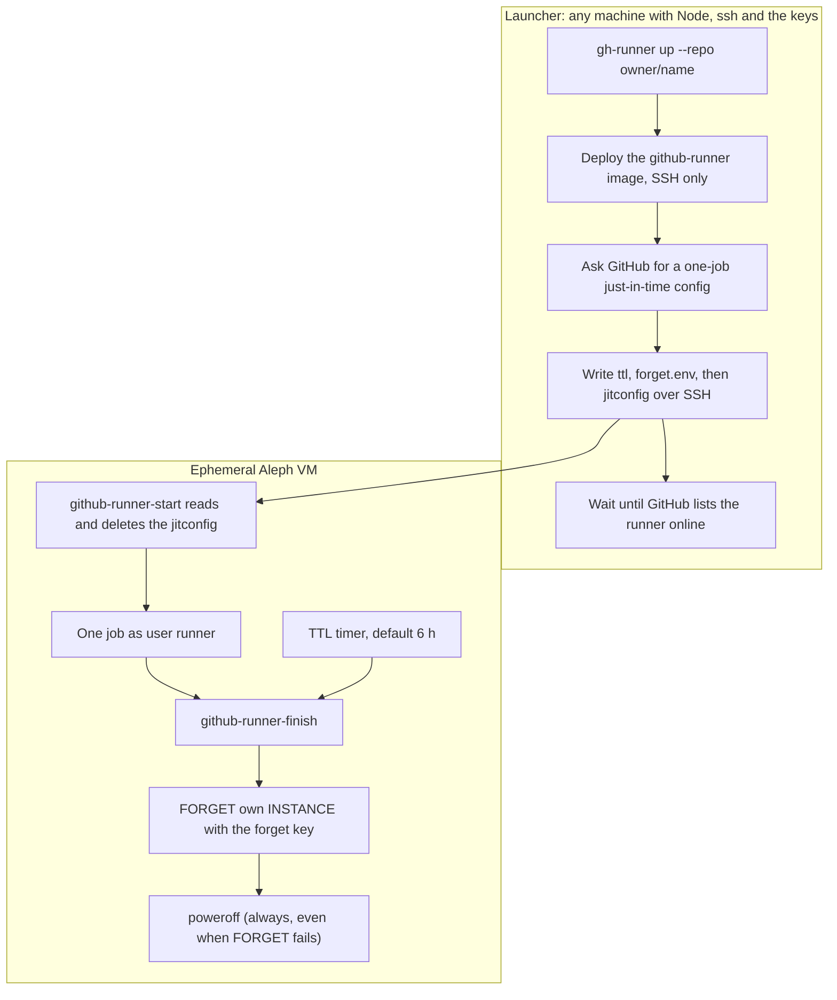

# Ephemeral GitHub Actions runner on Aleph

A self-hosted GitHub Actions runner in a temporary, plain (not confidential)
Aleph VM. Jobs that ask for `runs-on: [self-hosted, aleph]` run there instead
of on GitHub's hosted runners, so they need no hosted minutes. That matters
for private repositories, whose free minutes run out, and for jobs that need
their own kernel (loop devices, `nbd`, `dm_crypt`).

Each VM takes exactly one job, then removes itself.

## Lifecycle



## What the image holds

`packages/rootfs/reference/github-runner`: Debian 12, the GitHub
`actions-runner` at a pinned version (its sha256 is checked at build time and
the runner starts with updates off), Node.js 24, Docker, git, jq, and the tools
for building rootfs images (`qemu-utils`, `cryptsetup`, `debootstrap`). The
image carries **no credential**.

## Credentials and their reach

- **Just-in-time config.** It comes from
  `POST /repos/{owner}/{repo}/actions/runners/generate-jitconfig`, registers one
  runner for one job and cannot register another. The guest deletes it as soon
  as the runner has read it.
- **Forget key (optional).** Powering off does not end an Aleph allocation; the
  INSTANCE has to be forgotten. The runner wallet authorizes a separate key
  (`gh-runner authorize-forget`), and the launcher hands it to each VM. Aleph
  lets a delegate forget only messages it could have created itself, so the
  key needs `INSTANCE` as well as `FORGET`: with `FORGET` alone the VM's own
  FORGET is rejected. Job code can read the key, so it could start VMs paid by
  the wallet or forget the wallet's other instances. The runner VMs therefore
  belong to a **dedicated wallet** with a small balance that holds nothing
  else; images and long-lived relays stay on other wallets.
- **Without a forget key** the VM powers off after its job but stays allocated
  until `gh-runner down` or `gh-runner janitor` removes it.

## Commands

```bash
export ALEPH_VM_PRIVATE_KEY=…          # the dedicated runner wallet
export GH_RUNNER_ROOTFS_ITEM_HASH=…    # from the "GitHub Runner RootFS" workflow
export GH_RUNNER_FORGET_KEY=…          # optional, see above
pnpm relay-button gh-runner authorize-forget        # once per forget key
pnpm relay-button gh-runner up --repo owner/name --count 2
pnpm relay-button gh-runner list --repo owner/name
pnpm relay-button gh-runner janitor --repo owner/name
pnpm relay-button gh-runner down --all
```

The GitHub token comes from `GITHUB_TOKEN` or `gh auth token` and needs admin
rights on the repository.

## Public repositories

A self-hosted runner on a public repository runs workflow code from outside
pull requests. `up` refuses a public repository unless `--allow-public` says
that its workflows never run for forks.
