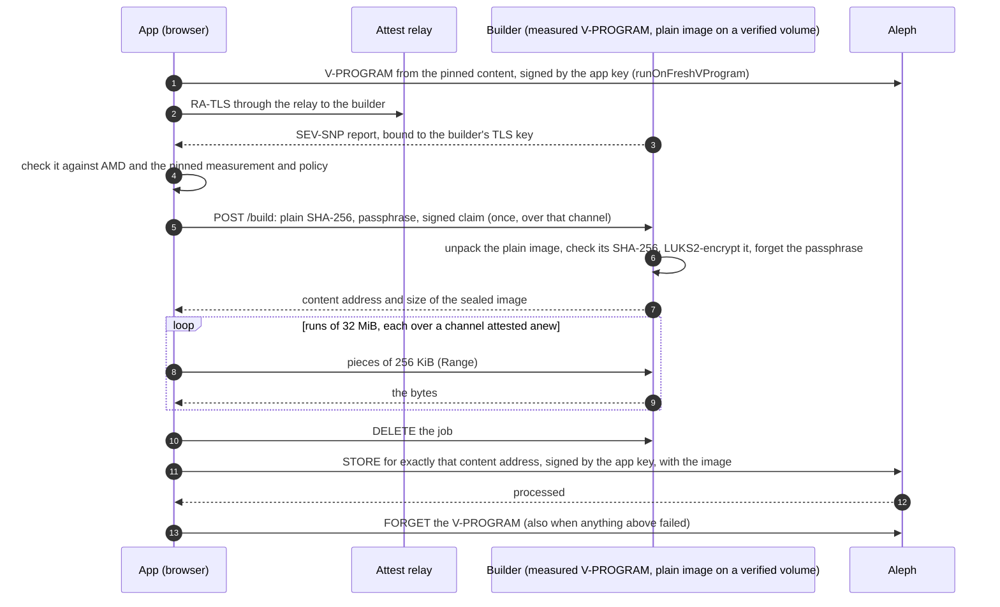

# Confidential VMs and sealed images

An app that starts a confidential VM on Aleph (AMD SEV-SNP) from the browser
unlocks it only after checking its attestation. Its root filesystem is an
encrypted image, and the passphrase that opens it travels only over a channel
the browser has attested. Three packages hold the code for that, so that each
app does not write it again:

| Package | What it does |
|---|---|
| `@le-space/aleph-vm` | Starts, attests and forgets an Aleph INSTANCE or V-PROGRAM from the browser or Node, signed by the app's own key on behalf of the account that pays. |
| `@le-space/sealed-image` | Has a measured builder seal a plain image with a passphrase the app derives, fetches it in runs over an attested relay, and stores it on Aleph as the app's own STORE. |
| `@le-space/build-journey` | Shows that build as a journey in stations while it runs: a pure model of its progress, facts and evidence, and a Svelte 5 view with the app's own words, stations and pins. |

The first two run unbuilt in a browser and in Node: plain ES modules, signing, API host
and `fetch` handed in, no app texts (errors carry a `code`, progress is data).
`@le-space/build-journey` keeps every word with the app too: its view asks
`text(key, vars)` for each one, and its model is plain ES modules as well.
The attestation itself is [`@le-space/attest-wasm`](./attest-relay.md)'s;
`attestedOpener` takes its `attestGuest` and the attest relays as arguments.

Paperless anywhere (Le-Space/paperless-anywhere) built and ran this code
first; the Belege bridge (Le-Space/belege#777) uses it for an image of its own.

## Public image and private image

A **public image** is one published image for everyone. Its passphrase is
handed to the app (a value in the app's release), so anyone who has the
image and the release can open it. It is fine for images that hold nothing
secret and need only to stay unchanged.

A **private image** is a copy of a public **plain image**, sealed for one
person with a passphrase only that person's app knows. The app derives it
from a root key it keeps (a vault's master secret):

```js
import { derivePassphrase } from '@le-space/sealed-image'

const passphrase = await derivePassphrase(masterSecret, {
  label: 'belege/bridge-image-passphrase/v1', // one per app and purpose
  plainSha256 // the plain image's SHA-256: a new plain image, a new passphrase
})
```

HKDF-SHA256, no salt, info `<label>/<plainSha256>`, 32 bytes as base64url.
With Paperless anywhere's label `paperless-anywhere/image-passphrase/v1` it
gives the passphrases Paperless anywhere has always derived.

## Who knows which passphrase

| | Public image | Private image |
|---|---|---|
| The app's release | yes | no |
| The person's app (vault) | yes | yes, derived when needed |
| The builder | – | for the minutes of one build, in memory, on `cryptsetup`'s stdin only |
| The VM | at each start, in memory | at each start, in memory |
| Le Space, Aleph, an attest relay | no | no |

## How a private image is made



```js
import { attestedOpener } from '@le-space/aleph-vm'
import { buildOnFreshBuilder } from '@le-space/sealed-image'

const built = await buildOnFreshBuilder({
  passphrase, // derived above; never sent anywhere but the attested builder
  app, // { address, signMessage({ message }) }: the app's own key
  payer, // optional: the account that pays and owns (default: app.address)
  channel: 'my-app', // the Aleph channel of the messages
  builder, // the pinned publication: program, crn, measurements, policy, plain
  opener: (running) => attestedOpener(running, loadAttest),
  onStarted: (vprogram) => noteInProfile(vprogram), // forget it at the next opening if the window closes
  onForgotten: () => clearNote(),
  onProgress: ({ step, data }) => show(step, data)
})
// built: { storeHash, cid, size, plainSha256, builtAt, attested }
```

`loadAttest` resolves to `{ attestGuest, wasm, relays, relayTransports }`:
`attestGuest` from `@le-space/attest-wasm/ratls`, the loaded WASM, the attest
relays the app uses, and a function that makes the transport for a route
over them.

## What the browser checks before anything is sent

1. **The builder's measurement and policy.** `attestedOpener` completes the
   RA-TLS handshake only for the measurements and the policy the app pins.
   A refused attestation is never retried over another relay.
2. **The builder's plain image.** Its gzipped plain image lies on a verified
   volume whose dm-verity root hash is on the measured boot line, so the
   measurement names the image. The builder also compares the SHA-256 the
   app asks for with the image it unpacked, and seals nothing else.
3. **The claim.** The first build request carries a `personal_sign` of
   `sealed image build`, the plain SHA-256 and the app's address. The builder
   then takes jobs only from that address; the app starts another builder
   when a different address claimed one first.
4. **Every run.** Each connection that carries pieces of the sealed image is
   attested like the first.
5. **The upload.** Aleph's node computes the content address of what it
   received; the app refuses a STORE for any other content address than the
   one the builder named.

A V-PROGRAM is a closed box: its firewall lets nothing in but the attested
port and drops the replies to outbound connections. The builder neither
fetches nor uploads; the sealed image leaves only through the attested
channel.

## Limits

| | |
|---|---|
| Plain image | at most 992 MiB unpacked (`MAX_PLAIN_BYTES`), whole 4 KiB blocks |
| Sealed image | the plain image plus 32 MiB, at most 1 GiB (Aleph's single upload) |
| Builder | 6144 MiB memory, 2 vCPUs; one image at a time in a 1200 MiB tmpfs |
| Fetch | 256 KiB pieces, 32 MiB runs, 3 connections side by side, 10 tries in a row without a piece |
| Upload | Aleph's API, then another API node, then the first again; only a gateway error (502, 503, 504) is tried again |

Paperless anywhere's plain image has 836 MiB, the Belege bridge's 959 MiB.

## The builder

One builder code (`packages/sealed-image/builder`), **published once per
plain image**: a publication holds one app's plain image on its verified
volume, so its measurement belongs to that image. Each app pins the
measurement of its own publication and changes it on its own release cycle.
`packages/sealed-image/builder/publications/` records each publication.

The workflow *Sealed image builder on Aleph*
(`.github/workflows/sealed-image-builder-publish.yml`) measures (`dry-run`),
publishes, checks, tries (`trial`), starts one again as an app does
(`again`, with `fixed` and a publication file) and deletes builders. After
`delete`, the volumes stay on Aleph and each build starts its own V-PROGRAM
from the pinned content: the measured boot line holds the runtime, the root
hashes and the resources, not the message's hash, so every such V-PROGRAM
shows the same measurement. `forget_volumes` forgets the volumes too, but
only STOREs that V-PROGRAM names, of the same account, smaller than any
image, and named in no publication file; one refusal forgets nothing.

The builder's protocol, its memory and size limits and the history of its
runs are in `packages/sealed-image/builder/vprogram/README.md`.

## Versions of a private image

`keepPrevious`, `releasePrevious`, `forgettable`, `forgetQueued` and
`fallbackPatch` keep the image a new build replaces as the way back until the
new one has started well, and queue it to forget afterwards, never forgetting
an image a profile starts from or a VM uses.
